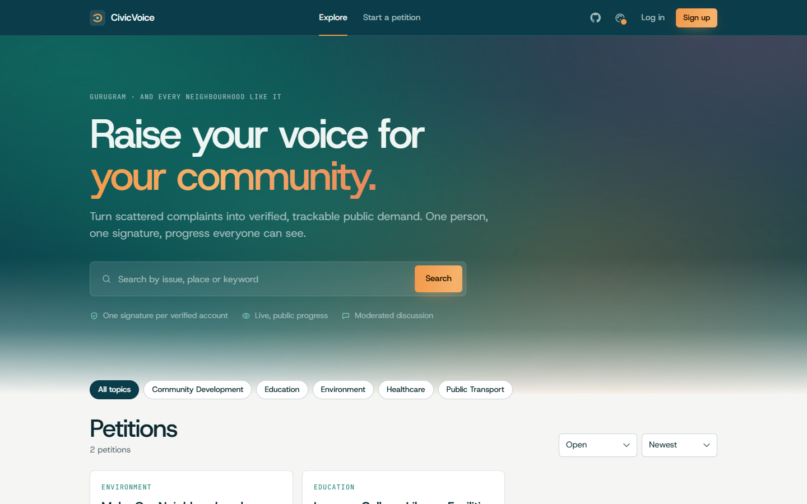
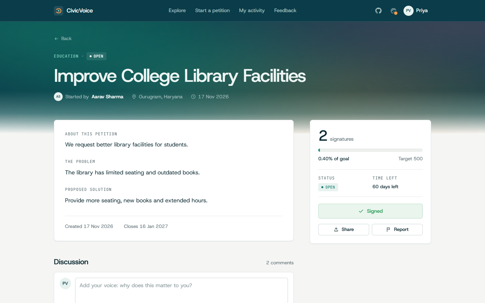
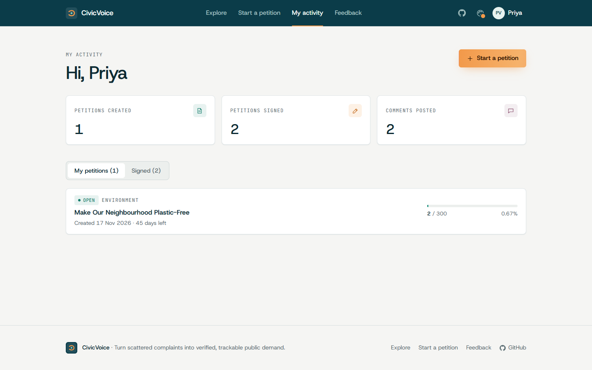
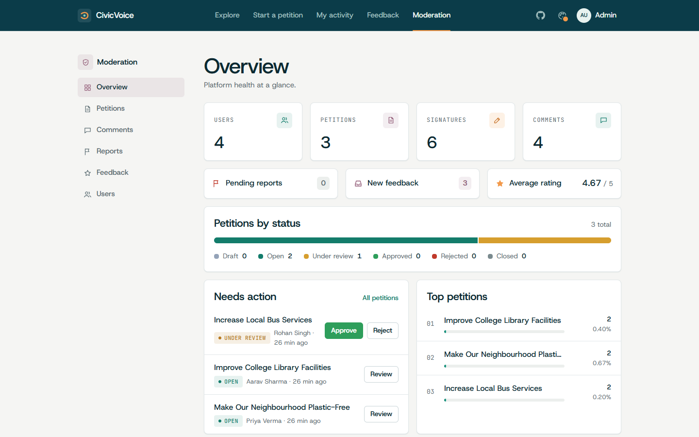
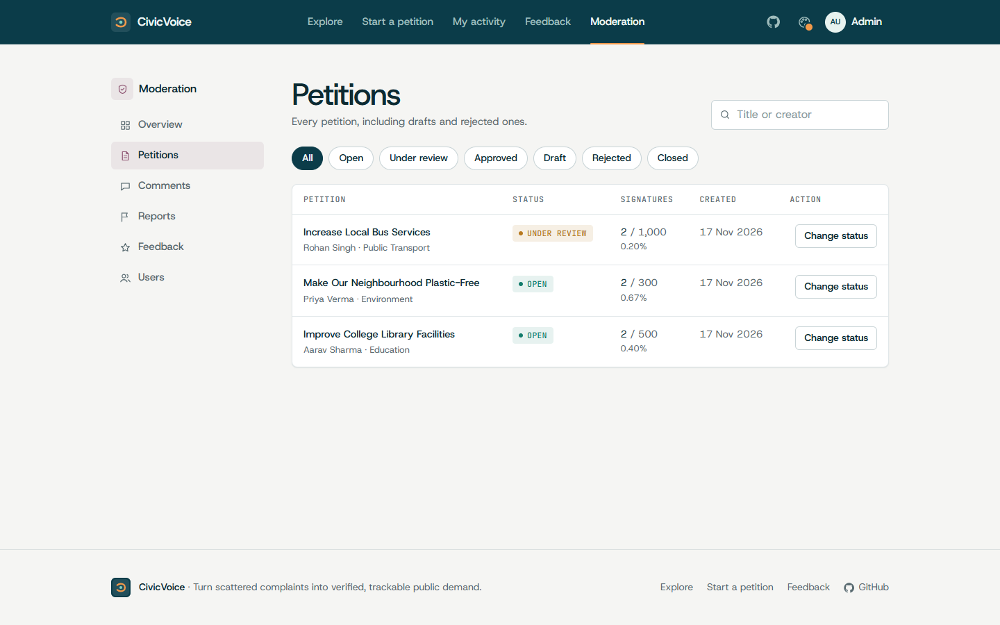
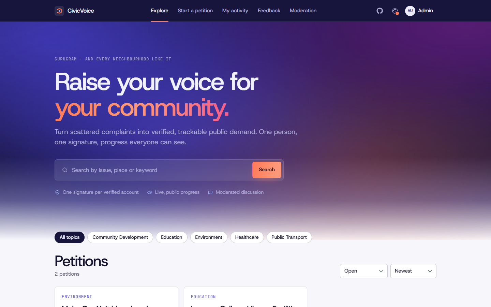

# CivicVoice

**Online Petition & Community Feedback Platform**: turn scattered complaints into verified, trackable public demand.

React 18 + Vite + Tailwind · Node/Express 4 · MySQL 8. The full spec is in [PROJECT_CONTEXT.md](PROJECT_CONTEXT.md).

## Screenshots

| Home | Petition (signed) |
|---|---|
|  |  |
| **My activity** | **Admin overview** |
|  |  |
| **Admin: petitions** | **Indigo palette** |
|  |  |

More in [`docs/screenshots`](docs/screenshots): login page and the phone layout.

## What's inside

```
civicvoice/
├── database/civicvoice_schema_v2.sql   tables, views, sp_sign_petition, seed data
├── server/                             REST API (26 endpoints) + Jest/Supertest tests
└── client/                             React app (public, user and admin screens)
```

## Run it locally

You need **Node 20+** and **MySQL 8**.

### 1. Database

Start MySQL (Windows: `net start MySQL80` from an admin terminal, or the Services app), then:

```bash
mysql -u root -p < database/civicvoice_schema_v2.sql
```

```bash
mysql -u root -p -e "CREATE USER IF NOT EXISTS 'civic'@'localhost' IDENTIFIED BY 'civicpass'; GRANT ALL ON civicvoice.* TO 'civic'@'localhost'; GRANT ALL ON civicvoice_test.* TO 'civic'@'localhost';"
```

### 2. API (port 5000)

```bash
cd server
npm install
cp .env.example .env      # then set a long random JWT_SECRET
npm run dev
```

Check it: `http://localhost:5000/api/health` → `{"status":"ok"}`

### 3. Web app (port 5173)

```bash
cd client
npm install
cp .env.example .env      # VITE_API_URL=http://localhost:5000/api
npm run dev
```

Open `http://localhost:5173`.

## Demo accounts

All use the password **`Password@123`** (the login page has one-click buttons).

| Name | Email | Role |
|---|---|---|
| Aarav Sharma | aarav@gmail.com | user |
| Priya Verma | priya@gmail.com | user |
| Admin User | admin@civicvoice.com | admin |
| Rohan Singh | rohan@gmail.com | user |

## Tests

The tests rebuild a separate `civicvoice_test` database before each file, so they never touch your dev data.

```bash
cd server
cp .env.test.example .env.test
npm test
```

37 tests cover API01–API21 from Section 14.2 of the spec, plus the status lifecycle, edit locking, comments, reports, feedback and the dashboard.

### Postman

Import `server/tests/civicvoice.postman_collection.json` into Postman. It has 45 requests covering all 26 endpoints and the negative cases API01–API21. Run it top to bottom with the Collection Runner against freshly seeded data: the login requests save tokens into collection variables, so the rest are authenticated automatically.

## Features

- **Auth**: register/login with JWT; every request re-checks the account in the DB, so a suspension works immediately even on an old token.
- **Petitions**: search, category chips, status filter, sort (newest / most signed / ending soon), pagination; create as draft or publish; edit while draft/published.
- **Signing**: always through `sp_sign_petition`; one signature per person, enforced by the database; the count and progress bar update without a reload.
- **Discussion**: comments with a 1,000-character counter; report a petition or a comment.
- **Feedback** with a 1–5 star rating.
- **My activity**: counts plus my petitions and signed petitions.
- **Colour palettes**: six palettes (Civic, Indigo, Forest, Klein, Terracotta, Noir) from the palette button in the navbar; the choice is remembered.
- **Moderation (admin)**: overview stats, petition status changes with a note (validated against the lifecycle table), comment visible/hidden/removed, report resolution, feedback review, user suspension.

## Design

The visual language follows the author's recent projects (LeashPay, the portfolio): Host Grotesk + JetBrains Mono, sharp 4–8 px corners, a soft `#F5F5F3` page, one deep panel with a soft gradient that slowly flows, saffron as the single "press me" colour. Motion follows Apple's fluid-interface guidance: feedback on press, critically damped springs (no overshoot) by default, a small bounce only after a physical action (signing, star rating), a translucent nav that content scrolls under, menus that grow from their trigger, and a phone bottom sheet you can flick down (velocity is projected forward to decide whether it closes). `prefers-reduced-motion`, `prefers-reduced-transparency` and `prefers-contrast` are all respected.

## Deployment (Render)

Render runs the API and the web app. It does not host MySQL, so the database goes on a free cloud MySQL (Aiven, TiDB Cloud or Railway).

1. **Database.** Create a MySQL 8 database on Aiven (or TiDB Cloud / Railway). Note its host, port, user, password and database name. Load the schema into it:
   ```bash
   mysql -h <host> -P <port> -u <user> -p --ssl-mode=REQUIRED <database> -e "source database/civicvoice_schema_v2_hosted.sql"
   ```
   Use the `_hosted` file: cloud hosts don't allow `DROP/CREATE DATABASE`.
2. **Push the repo to GitHub.**
3. **Render → New → Blueprint**, pick the repo. `render.yaml` creates two services:
   - `civicvoice-api`: Node web service from `server/`
   - `civicvoice-web`: static site from `client/`, with the SPA rewrite
4. Fill in the values Render asks for:
   - API: `DB_HOST`, `DB_PORT`, `DB_USER`, `DB_PASSWORD`, `DB_NAME` from step 1. `JWT_SECRET` is generated for you, and `DB_SSL` is already `true`.
   - Web: `VITE_API_URL` = the API's URL + `/api`, for example `https://civicvoice-api.onrender.com/api`.
   - API: `CLIENT_URL` = the web app's URL, for example `https://civicvoice-web.onrender.com`. It must match exactly, with no trailing slash, because CORS checks it.
5. After setting `VITE_API_URL`, redeploy the static site: Vite bakes it in at build time.
6. Open `https://civicvoice-api.onrender.com/api/health`. It should return `{"status":"ok"}`.

Notes: a free Render web service sleeps after 15 minutes idle, so the first request after that takes about 30–50 seconds. Change the demo passwords before sharing the live link. `client/vercel.json` and `client/public/_redirects` also make the frontend deployable on Vercel or Netlify.
